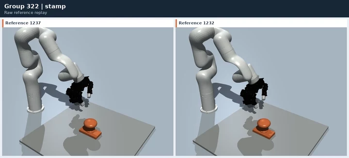
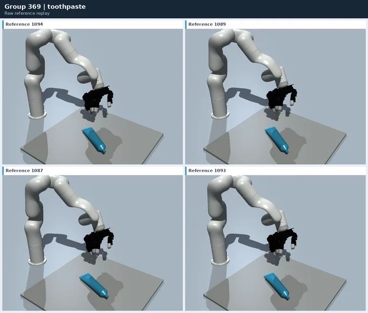
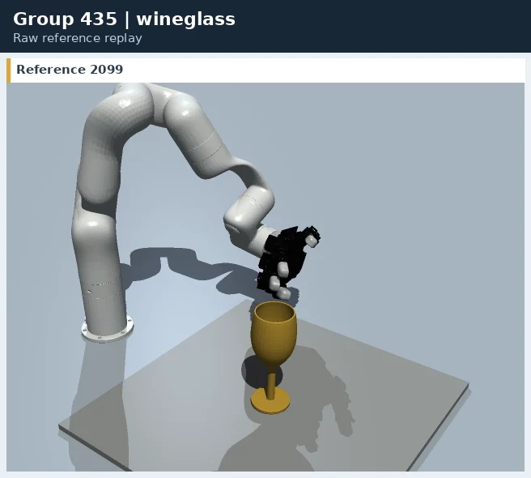

<h1 align="center">AdaDexTrack: Dynamic Modulation for Adaptive and Generalizable Dexterous Manipulation Tracking</h1>

<h3 align="center">CVPR 2026</h3>

<p align="center">
  <a href="https://janebek.github.io/AdaDexTrack/">Project website</a> ·
  <a href="https://openaccess.thecvf.com/content/CVPR2026/papers/Adalibieke_AdaDexTrack_Dynamic_Modulation_for_Adaptive_and_Generalizable_Dexterous_Manipulation_Tracking_CVPR_2026_paper.pdf">Paper</a> ·
  <a href="https://www.youtube.com/watch?v=eziNDfpwego">Video</a> ·
  <a href="https://huggingface.co/datasets/Janebek/AdaDexTrack">Dataset</a>
</p>

<p align="center">
  <a href="https://www.sqz.ac.cn/en"></a>
  &nbsp;&nbsp;&nbsp;&nbsp;
  <a href="https://www.tsinghua.edu.cn/en/"></a>
  &nbsp;&nbsp;&nbsp;&nbsp;
  <a href="https://www.ucsd.edu/"></a>
</p>

<p align="center">
  <a href="https://janebek.github.io/AdaDexTrack/videos/teaserv2.mp4" title="Watch the original 1080p video"></a>
</p>

This repository provides the AdaDexTrack pipeline: reference replay, semantic specialist training, demonstration collection, generalist BC training, and modulator training and inference. It includes **2,765 reference motions, 50 objects and 444 semantic groups**, with pretrained specialists, BC trackers, modulators and an object autoencoder.

## Table of Contents

### [1. Preparation and data visualization](#preparation-and-data-visualization)

- [Step 1: Installation](#step-1-installation)
- [Step 2: Download resources and inspect the dataset](#step-2-download-resources-and-inspect-the-dataset)
- [Step 3: Replay reference motions](#step-3-replay-reference-motions)

### [2. Specialist training and inference](#specialist-training-and-inference)

- [Step 1: Train semantic specialists](#step-1-train-semantic-specialists)
- [Step 2: Run specialist inference and evaluation](#step-2-run-specialist-inference-and-evaluation)

### [3. Generalist training and inference](#generalist-training-and-inference)

- [Step 1: Collect specialist demonstrations](#step-1-collect-specialist-demonstrations)
- [Step 2: Train the generalist BC tracker](#step-2-train-the-generalist-bc-tracker)
- [Step 3: Run BC inference and evaluation](#step-3-run-bc-inference-and-evaluation)

### [4. Modulator training and inference](#modulator-training-and-inference)

- [Step 1: Train the modulator](#step-1-train-the-modulator)
- [Step 2: Run modulator inference and evaluation](#step-2-run-modulator-inference-and-evaluation)

### [5. Sim2real deployment](#sim2real-deployment)

- [Step 1: Set up hardware and APIs](#step-1-set-up-hardware-and-apis)
- [Step 2: Calibrate coordinate frames and estimate object poses](#step-2-calibrate-coordinate-frames-and-estimate-object-poses)
- [Step 3: Assemble observations and run policy inference](#step-3-assemble-observations-and-run-policy-inference)
- [Step 4: Connect policy outputs to robot control](#step-4-connect-policy-outputs-to-robot-control)

[License and credits](#license-and-credits) · [Citation](#citation)

<a name="preparation-and-data-visualization"></a>

# 1. Preparation and data visualization

### Step 1: Installation

**For Ubuntu 20.04, follow the [complete installation guide](docs/install_ubuntu20.md).** It covers Ubuntu packages, NVIDIA drivers, Conda, the SDK download, environment setup, resource installation, first runs and troubleshooting.

This release targets **Ubuntu 20.04.6 with NVIDIA driver 535.161.07**. The project uses **Python 3.8.18, PyTorch 2.4.1 with CUDA 12.1, NumPy 1.23.5 and standalone Isaac Gym Preview 4**.

If Conda and a suitable NVIDIA driver are already installed:

```bash
git clone https://github.com/Janebek/AdaDexTrack.git
cd AdaDexTrack
conda env create -f environment.yml
conda activate adadextrack
export LD_LIBRARY_PATH="$CONDA_PREFIX/lib:${LD_LIBRARY_PATH:-}"
export MAX_JOBS=2
```

Download the Isaac Gym Preview 4 release from the [NVIDIA website](https://developer.nvidia.com/isaac-gym).

```bash
cd isaacgym/python
pip install -e .
```

Continue from the cloned `AdaDexTrack/` repository root in the activated environment.

### Step 2: Download resources and inspect the dataset

Runtime resources are available from [Hugging Face](https://huggingface.co/datasets/Janebek/AdaDexTrack): `assets.tar.gz` includes object meshes, robot models, textures and latents; `references.tar.gz` contains the full corpus; `bc_tracker_unseen_ref.pth` is the unseen-reference (unseen-trajectory) tracker and `bc_tracker_unseen_obj.pth` is the unseen-object tracker. The two pretrained modulators are `modulator_unseen_ref.pth` and `modulator_unseen_obj.pth`, paired with their corresponding BC trackers. Publication status and the pinned Hub revision are recorded in `configs/artifact_release.json`.

After completing the environment and SDK setup, run from the repository root:

```bash
python scripts/download_resources.py
# Only object/robot assets, textures and latents:
python scripts/download_resources.py --components assets
```

The public resources need no Hugging Face login. The downloader automatically verifies archive and per-file SHA256 checksums, restores the runtime directories and rejects conflicting local files. Use `--revision <full Hub commit hash>` to pin a version. Third-party resources retain their source terms; the code license does not replace them. See [resource distribution](docs/resource_distribution.md) and [resource terms](docs/resource_licenses.md).

#### Dataset

| Manifest under `data/adadextrack_full/` | References |
|---|---:|
| `manifest.csv` | 2,765 |
| `splits/unseen_trajectory_train.csv` | 2,212 |
| `splits/unseen_trajectory_test.csv` | 553 |
| `splits/unseen_object_train.csv` | 2,520 |
| `splits/unseen_object_test.csv` | 245 |

Split membership and ordering match the original paper CSVs. All manifests share reference IDs `0–2764` and group IDs `0–443`; each motion is stored once. These IDs are local to this released corpus. `semantic_groups.csv` and `groups/` index semantic groups; `provenance/source_mapping.csv` records source labels and teacher IDs. Descriptions currently retain the source semantic base strings.

The reference arrays are distributed byte-for-byte with SHA256 checksums. No additional height, BC-success, or accuracy filtering is applied. `scripts/import_full_dataset.py` records the one-time import procedure; the released runtime uses the files in this repository.

##### Object latents and AE (optional)

The resource download includes the fixed latents used by the released policies. Use the optional AE workflow below to train an encoder or produce new latents.

Object geometry follows **mesh → surface sampling (2,048 points) → mean-center
and unit-sphere normalization → encoder → 64-dimensional latent**. The decoder
maps a latent back to a normalized point cloud. We provide the original AE
weights and 57 input meshes (55 training / 2 validation,
with `rubberduck` and `flute` in validation).
See the [object AE tutorial](docs/object_ae.md).

```bash
# Optional AE dependencies and resources; independent of Isaac Gym
pip install -e '.[object-ae]'
python scripts/download_resources.py --components object_ae object_ae_data

# Train from scratch, or encode with the released AE
python scripts/object_ae.py train
python scripts/object_ae.py encode \
  --checkpoint checkpoints/object_ae.pth --input data/object_ae/meshes \
  --output-dir outputs/object_ae/latents --seed 42

# Decode the fixed latents used by the released policies
python scripts/object_ae.py decode \
  --checkpoint checkpoints/object_ae.pth --latent-dir assets/latents \
  --output-dir outputs/object_ae/reconstruction
```

**Paper evaluation uses the fixed published `assets/latents`.** Explicitly seeded
re-encoding produces new reproducible representations and does not promise the
old latent bytes. For a new AE, train specialists, BC and modulator with the same
new `--latents-dir`; do not mix representation spaces and trained policies.

### Step 3: Replay reference motions

Replay supports two modes: semantic groups (the default), or fixed-size
reference batches for an overview of the corpus. The default data source
contains three example groups:

| Group | Object | Reference IDs |
|---|---|---|
| 322 | stamp | 1237, 1232 |
| 369 | toothpaste | 1094, 1089, 1087, 1093 |
| 435 | wineglass | 2099 |

These seven references belong to the unseen-trajectory training split and use
the full corpus IDs and files. Training, replay and BC comparison use the same
example manifest, `data/adadextrack_full/examples/specialists.csv`.

<table>
  <tr>
    <th align="center">Group 322 · stamp<br>2 references</th>
    <th align="center">Group 369 · toothpaste<br>4 references</th>
    <th align="center">Group 435 · wineglass<br>1 reference</th>
  </tr>
  <tr>
    <td align="center" valign="top"><a href="https://janebek.github.io/AdaDexTrack/static/demos/replay_group_322.mp4"></a></td>
    <td align="center" valign="top"><a href="https://janebek.github.io/AdaDexTrack/static/demos/replay_group_369.mp4"></a></td>
    <td align="center" valign="top"><a href="https://janebek.github.io/AdaDexTrack/static/demos/replay_group_435.mp4"></a></td>
  </tr>
</table>

Each preview includes every reference in its group, with matching close camera
views. These are direct kinematic replays, including the original hand–object
interpenetration. Click a preview for the complete, full-resolution recording.

```bash
# Default example: group 322, both references together, three loops
python scripts/replay.py --group-id 322 --loops 3
python scripts/replay.py --group-id 369
python scripts/replay.py --group-id 435

# All three example groups, one after another
python scripts/replay.py --all

# Full corpus: all 444 semantic groups, one group per window
python scripts/replay.py --dataset full --all --overview

# Alternative: all 2,765 references in 11 batches (10 x 256 + 205)
python scripts/replay.py --dataset full --all --mode batch --batch-size 256 --overview

# Training partitions, using their complete group membership
python scripts/replay.py --dataset unseen_ref --all
python scripts/replay.py --dataset unseen_obj --all
```

Replay writes reference object poses and 22 robot joint positions before
rendering. Playback defaults to 12 FPS; `--fps` adjusts speed and `--loops`
applies to each group or batch. Each window runs in a fresh simulator process.
Closing the window or pressing Ctrl+C stops the entire playback. Recordings
and logs are written under `outputs/replay/<run>/group_NNN/` in group mode,
or `outputs/replay/<run>/batch_NNN/` in batch mode.

For custom selections, use `--manifest path/to/manifest.csv --all`; rows must
follow the released manifest schema. In the default `--mode group`, each
window contains exactly one complete selected group. In `--mode batch`,
references retain manifest order and can span groups; `--batch-size` defaults
to 256 and is available only in this mode. Individual `--reference-id`
selections remain available for debugging.

<br>

---

<a name="specialist-training-and-inference"></a>

# 2. Specialist training and inference

### Step 1: Train semantic specialists

**One semantic group corresponds to one specialist.** Groups sharing the same
object still train separate policies. The default is one GPU and sequential
training of the three example specialists above.

```bash
# Three example specialists, each initialized from scratch
python scripts/train_specialists.py

# One example group
python scripts/train_specialists.py --group-id 322

# All training groups in either paper split
python scripts/train_specialists.py --dataset unseen_ref --all
python scripts/train_specialists.py --dataset unseen_obj --all

# Optional: train one independent specialist per GPU
python scripts/train_specialists.py --dataset unseen_ref --all --gpus 0 1

# Resume incomplete groups; completed groups are skipped
python scripts/train_specialists.py --resume
```

Defaults are 8,192 environments per specialist, 2,001 PPO epochs, seed 42, and
the first visible GPU. Training retains the original reward, PPO parameters
and randomization, including initial XY ±5 cm and yaw ±30 degrees. The full
unseen-ref and unseen-object training partitions contain 435 and 402 groups,
respectively; test references are excluded. Outputs are isolated by data
source and group, with `best.pth`, `last.pth`, configuration and logs. See the
[specialist tutorial](docs/specialists.md) for budgets, GPU selection, resume
and checkpoint details.

Checkpoints are saved as `best.pth` and `last.pth` under
`outputs/specialists/<dataset>/group_NNN/`.

### Step 2: Run specialist inference and evaluation

We also provide **pretrained example specialists** for groups 322, 369 and 435,
trained for 2,001 PPO epochs. Download them without retraining:

```bash
python scripts/download_resources.py --components example_specialists

# Visualize the released stamp specialist on its two example references
python scripts/infer_bc.py \
  --ref-csv data/adadextrack_full/examples/specialists.csv \
  --group-id 322 \
  --checkpoint checkpoints/specialists/examples/group_322/best.pth \
  --device cuda:0 --seed 42 --render
```

Their Mean-error rates are all 100%; Completion is 100%, 79.67% and 100%,
respectively, on the seven example references (seed 42, full 300 frames,
initial perturbations disabled). See the [per-group metrics](docs/specialists.md#released-example-specialists).

<table>
  <tr>
    <th align="center">Group 322 · stamp<br>2 references</th>
    <th align="center">Group 369 · toothpaste<br>4 references</th>
    <th align="center">Group 435 · wineglass<br>1 reference</th>
  </tr>
  <tr>
    <td align="center" valign="top"><a href="https://janebek.github.io/AdaDexTrack/static/demos/specialist_group_322.mp4?v=279bf92d8c9a"></a></td>
    <td align="center" valign="top"><a href="https://janebek.github.io/AdaDexTrack/static/demos/specialist_group_369.mp4?v=bf67ebe92d33"></a></td>
    <td align="center" valign="top"><a href="https://janebek.github.io/AdaDexTrack/static/demos/specialist_group_435.mp4?v=1460fa084da8"></a></td>
  </tr>
</table>

These videos show specialist inference results with physics simulation enabled.
Click a preview for the complete, full-resolution recording.

```bash
# Compare the pretrained BC tracker on the selected stamp references
python scripts/infer_bc.py \
  --ref-csv data/adadextrack_full/examples/specialists.csv \
  --group-id 322 --checkpoint checkpoints/bc_tracker_unseen_ref.pth \
  --device cuda:0 --seed 42 --render

# Infer with the corresponding trained specialist
python scripts/infer_bc.py \
  --ref-csv data/adadextrack_full/examples/specialists.csv \
  --group-id 322 \
  --checkpoint outputs/specialists/examples/group_322/best.pth \
  --device cuda:0 --seed 42 --render
```

For the other examples, change the group ID to 369 or 435 and use its matching
checkpoint directory. The inference entry point loads the network architecture
embedded in specialist checkpoints and remains compatible with both BC
trackers below. Omit `--render` for headless policy inference.

Inference saves `per_reference.csv`, `summary.json` and raw trajectories under
`logs/adadextrack_full/bc_eval/<run>/`.

<br>

---

<a name="generalist-training-and-inference"></a>

# 3. Generalist training and inference

### Step 1: Collect specialist demonstrations

Collect demonstrations from one specialist per semantic group. Complete
[Specialist Step 1](#step-1-train-semantic-specialists), or use the released
example checkpoints below. The example uses the same three specialists and
seven references introduced in the preparation section.

```bash
# Automatically load each trained example specialist's best.pth
python scripts/collect_specialists.py
```

To use the released example specialists:

```bash
python scripts/download_resources.py --components example_specialists
python scripts/collect_specialists.py --specialist-root checkpoints/specialists
```

These two example collection commands are alternatives; choose a fresh
`--output-dir` if demonstrations already exist. The released specialists cover
only the seven example references. For the full training partitions, first
train the corresponding full-group specialists, then collect:

```bash
# Collect demonstrations from all 435 unseen-reference specialists
python scripts/collect_specialists.py --dataset unseen_ref --all

# Collect demonstrations from all 402 unseen-object specialists
python scripts/collect_specialists.py --dataset unseen_obj --all
```

Collection automatically finds
`outputs/specialists/<dataset>/group_NNN/best.pth`; use `--specialist-root` for
another checkpoint root. Group and training-reference membership are checked
before starting workers. The two full experiments remain separate and exclude
test references.

Collection defaults to one GPU and processes groups sequentially. Add
`--gpus 0 1 2 3` to schedule independent groups on available GPUs. Every rollout
is kept, with XY ±5 cm / yaw ±30 degree perturbations, specialist domain
randomization, 20 environments per reference and 10 rounds by default.
Demonstrations are saved under `outputs/bc_data/<dataset>/`.

### Step 2: Train the generalist BC tracker

Train **one generalist BC tracker across all selected groups** using the
collected demonstrations. The example, unseen-reference and unseen-object
experiments each produce a separate tracker:

```bash
# One example tracker from the three specialists' demonstrations
python scripts/train_bc.py

# One unseen-reference tracker from the 2,212-reference training set
python scripts/train_bc.py --dataset unseen_ref

# One unseen-object tracker from the 2,520-reference training set
python scripts/train_bc.py --dataset unseen_obj
```

BC defaults to one GPU, 100 epochs and batch size 2,000; `--device` selects the
GPU. Full datasets are read in bounded CPU shards. These are configurable
budgets, not a guarantee of reproducing the published trackers. New weights
are saved as `best.pth` and `last.pth` under `outputs/bc/<dataset>/`.
See the [BC training tutorial](docs/bc_training.md) for collection budgets,
checkpoint discovery, data format, full-split evaluation and resume.

### Step 3: Run BC inference and evaluation

Visualize and evaluate the example tracker trained in Step 2:

```bash
python scripts/infer_bc.py \
  --ref-csv data/adadextrack_full/examples/specialists.csv \
  --checkpoint outputs/bc/examples/best.pth \
  --device cuda:0 --seed 42 --render
```

We provide **two pretrained BC trackers**, both with 273 observations and 22 actions:

| Tracker | Checkpoint | Training references | Test references |
|---|---|---:|---:|
| Unseen reference / unseen trajectory | `checkpoints/bc_tracker_unseen_ref.pth` | 2,212 | 553 |
| Unseen object | `checkpoints/bc_tracker_unseen_obj.pth` | 2,520 | 245 |

Use the matching checkpoint and split for each experiment. Without `--checkpoint`, inference uses the unseen-reference tracker; without `--ref-csv`, it runs the full corpus for visualization. Add `--render` to any inference command below to open the viewer.

```bash
# All references, with a viewer (unseen-reference tracker)
python scripts/infer_bc.py \
  --checkpoint checkpoints/bc_tracker_unseen_ref.pth \
  --batch-size 256 --device cuda:0 --seed 42 --render

# Unseen-reference training set: 2,212 references
python scripts/infer_bc.py \
  --ref-csv data/adadextrack_full/splits/unseen_trajectory_train.csv \
  --checkpoint checkpoints/bc_tracker_unseen_ref.pth \
  --batch-size 256 --device cuda:0 --seed 42

# Unseen-object training set: 2,520 references
python scripts/infer_bc.py \
  --ref-csv data/adadextrack_full/splits/unseen_object_train.csv \
  --checkpoint checkpoints/bc_tracker_unseen_obj.pth \
  --batch-size 256 --device cuda:0 --seed 42

# Unseen-reference test set: 553 references, one environment per reference
python scripts/infer_bc.py \
  --ref-csv data/adadextrack_full/splits/unseen_trajectory_test.csv \
  --checkpoint checkpoints/bc_tracker_unseen_ref.pth \
  --batch-size 553 --device cuda:0 --seed 42

# Unseen-object test set: 245 references, one environment per reference
python scripts/infer_bc.py \
  --ref-csv data/adadextrack_full/splits/unseen_object_test.csv \
  --checkpoint checkpoints/bc_tracker_unseen_obj.pth \
  --batch-size 245 --device cuda:0 --seed 42

# Recompute metrics from a completed inference run
python scripts/evaluate.py --run-dir "logs/adadextrack_full/bc_eval/<run>"
```

Inference saves its timestamped run under `logs/adadextrack_full/bc_eval/`.
Replace `<run>` above with that directory name.

Inference uses action means, evaluation mode, and frozen observation normalization. Initial object XY/yaw perturbations, additional domain randomization, and delays are disabled; the task's observation noise is retained. Each reference runs once for 300 frames. Results include `per_reference.csv`, `summary.json`, and raw batch trajectories. The viewer initially focuses on the first environment in each batch.

Metrics use Euclidean object/wrist position errors, quaternion angular errors, and the MAE of the 16 finger joints over all 300 frames. Mean-error success and Completion use combined position, combined rotation, and finger thresholds of 10 cm, 60 degrees, and 40 degrees. See [the metric definitions](docs/metrics.md). Test each with its matching manifest, as shown above. Batching and retained observation noise can affect numerical reproduction of a particular run.

<br>

---

<a name="modulator-training-and-inference"></a>

# 4. Modulator training and inference

### Step 1: Train the modulator

Train one modulator over the selected training partition, using its pretrained
BC tracker as the frozen controller. BC weights and observation normalization
remain fixed; PPO updates only the 273-observation, 202-action modulator.

```bash
# Provided unseen-reference and unseen-object BC trackers
python scripts/train_modulator.py --dataset unseen_ref
python scripts/train_modulator.py --dataset unseen_obj

# Use your own BC tracker from the example pipeline
python scripts/train_modulator.py --dataset examples \
  --tracker-checkpoint outputs/bc/examples/best.pth

# Resume an interrupted run
python scripts/train_modulator.py --dataset unseen_ref --resume
```

Defaults are one GPU, 8,192 environments, 30,000 PPO epochs and seed 42.
Training uses XY ±5 cm / yaw ±30 degree perturbations and the existing training
randomization. Checkpoints and logs are under `outputs/modulator/<dataset>/`;
paired BC and latent checksums are recorded. The 202 actions retain the original
116 reference adjustments, 64 latent values and 22 action residuals, including
their execution timing. See the [modulator tutorial](docs/modulator.md) for
configuration, custom BC/latents and resume details.

### Step 2: Run modulator inference and evaluation

We provide **two pretrained modulators**, both with 273 observations and 202 actions:

| Modulator | Checkpoint | Frozen BC tracker | Training references | Test references |
|---|---|---|---:|---:|
| Unseen reference / unseen trajectory | `checkpoints/modulator_unseen_ref.pth` | `checkpoints/bc_tracker_unseen_ref.pth` | 2,212 | 553 |
| Unseen object | `checkpoints/modulator_unseen_obj.pth` | `checkpoints/bc_tracker_unseen_obj.pth` | 2,520 | 245 |

The modulator and its BC tracker run together. `--dataset` automatically selects
the matching released pair and test split. New users receive both pairs with
`python scripts/download_resources.py`. To add just the modulators to an existing
installation:

```bash
python scripts/download_resources.py --components modulator_unseen_ref modulator_unseen_obj
```

```bash
# All 2,765 references in batches, with a viewer (unseen-reference model)
python scripts/infer_modulator.py --dataset unseen_ref \
  --ref-csv data/adadextrack_full/manifest.csv \
  --batch-size 256 --device cuda:0 --seed 42 --render

# Unseen-reference test set: 553 references, one environment per reference
python scripts/infer_modulator.py --dataset unseen_ref \
  --checkpoint checkpoints/modulator_unseen_ref.pth \
  --tracker-checkpoint checkpoints/bc_tracker_unseen_ref.pth \
  --batch-size 553 --device cuda:0 --seed 42

# Unseen-object test set: 245 references, one environment per reference
python scripts/infer_modulator.py --dataset unseen_obj \
  --checkpoint checkpoints/modulator_unseen_obj.pth \
  --tracker-checkpoint checkpoints/bc_tracker_unseen_obj.pth \
  --batch-size 245 --device cuda:0 --seed 42

# Unseen-reference training set: 2,212 references
python scripts/infer_modulator.py --dataset unseen_ref --split train \
  --batch-size 256 --device cuda:0 --seed 42

# Unseen-object training set: 2,520 references
python scripts/infer_modulator.py --dataset unseen_obj --split train \
  --batch-size 256 --device cuda:0 --seed 42

# Use the modulator and BC tracker trained in the example pipeline
python scripts/infer_modulator.py --dataset examples \
  --checkpoint outputs/modulator/examples/best.pth \
  --tracker-checkpoint outputs/bc/examples/best.pth --render
```

Add `--render` to any inference command to open a viewer. Evaluation uses the same
L2 position errors, quaternion angular errors, finger MAE, Mean-error success and
Completion as BC, over all 300 frames. Initial XY/yaw perturbations, additional
domain randomization and lag are disabled; observation noise is retained. Raw
trajectories, `per_reference.csv` and `summary.json` are saved under
`outputs/modulator_eval/<dataset>/<run>/`. The original checkpoint files retain
their weights and normalization; compatibility metadata is provided by the
checksummed checkpoint registry. See [the modulator tutorial](docs/modulator.md).

<br>

---

<a name="sim2real-deployment"></a>

# 5. Sim2real deployment

We provide a [deployment tutorial](docs/sim2real.md) and
[interface examples](examples/sim2real/) for xArm6, LEAP Hand and an
Intel RealSense D435 RGB-D camera. These building blocks require your
hardware drivers, vision setup and calibration.

### Step 1: Set up hardware and APIs

Install the [xArm SDK](https://github.com/xArm-Developer/xArm-Python-SDK),
[LEAP Hand ROS1 API](https://github.com/leap-hand/LEAP_Hand_API/tree/main/ros_module)
and [RealSense ROS1 driver](https://github.com/realsenseai/realsense-ros/tree/ros1-legacy).
Fill in the device and calibration fields in
[config.example.yaml](examples/sim2real/config.example.yaml). The xArm controller
uses the position-to-velocity structure from
[BunnyVisionPro](https://github.com/Dingry/BunnyVisionPro/blob/main/real_control/xarm7_ability.py).

### Step 2: Calibrate coordinate frames and estimate object poses

Calibrate the fixed external camera with
[easy_handeye](https://github.com/IFL-CAMP/easy_handeye), using
**`eye_on_hand=false`** (eye-to-hand). We provide an
[xArm/ArUco launch example](examples/sim2real/eye_to_hand.launch) and
[instructions for exporting `T_base_camera`](docs/sim2real.md#eye-to-hand-calibration).

Set up [FoundationPose](https://github.com/NVlabs/FoundationPose) with your RGB-D
camera and matching object mesh. Transform its output into the reference/robot
base frame and publish `base_link → object_frame`. The tutorial defines the
calibration matrices, mesh origin, units and timestamp interface.

### Step 3: Assemble observations and run policy inference

Select a reference from the full manifest and the matching pretrained BC/modulator
pair. The examples assemble the 273 observation features with the fixed published
object latent and use the same modulation, cached-observation timing and action
composition as simulation. BC-only inference is also supported.

### Step 4: Connect policy outputs to robot control

Run the policy at **12 Hz** and the xArm position-to-velocity controller at
**250 Hz**. The 22 position targets drive six arm joints and 16 hand joints;
the example adapters handle the SDK/ROS calls and joint ordering. Follow the
[control-cycle example](docs/sim2real.md#step-4-connect-policy-outputs-to-robot-control)
when integrating these interfaces into your application.

<br>

---

## License and credits

Code is released under [BSD-3-Clause](LICENSE). Retained third-party notices and resource attribution are listed in [THIRD_PARTY_NOTICES.md](THIRD_PARTY_NOTICES.md). Third-party code and resources retain their respective terms; the repository's code license does not replace them.

### Citation

```bibtex
@InProceedings{Adalibieke_2026_CVPR,
  author    = {Adalibieke, Jianibieke and Han, Qianwei and Liu, Xueyi and Qin, Yuzhe and Yi, Li},
  title     = {AdaDexTrack: Dynamic Modulation for Adaptive and Generalizable Dexterous Manipulation Tracking},
  booktitle = {Proceedings of the IEEE/CVF Conference on Computer Vision and Pattern Recognition (CVPR)},
  month     = {June},
  year      = {2026},
  pages     = {28021-28031}
}
```
