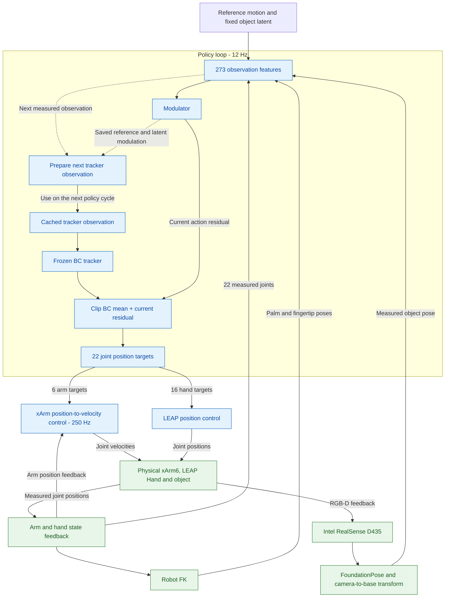

# Sim2real deployment

This tutorial describes the interfaces and policy data flow for xArm6, LEAP Hand
and an Intel RealSense D435 RGB-D camera.
The Python files in [examples/sim2real](../examples/sim2real/) are building blocks
for your control application. They do not connect devices on import and do not
provide a complete hardware launch command.



The robot closes the policy loop through joint-state and RGB-D feedback. The arm
also closes its own 250 Hz position-to-velocity loop. Reference and latent
modulation is cached for the next policy cycle; the action residual acts in the
current cycle.

## Step 1: Set up hardware and APIs

Use Ubuntu 20.04 with ROS1 Noetic for the ROS interfaces shown here. Complete
the repository installation and resource download first. The hardware examples
do not require an Isaac Gym simulation.

Install [xArm-Python-SDK](https://github.com/xArm-Developer/xArm-Python-SDK),
the [LEAP Hand ROS1 API](https://github.com/leap-hand/LEAP_Hand_API/tree/main/ros_module)
and the [RealSense ROS1 driver](https://github.com/realsenseai/realsense-ros/tree/ros1-legacy)
following their upstream instructions. The FK example additionally uses
[pytorch_kinematics](https://github.com/UM-ARM-Lab/pytorch_kinematics):

```bash
pip install xarm-python-sdk pytorch-kinematics==0.7.5
```

Build/source the LEAP ROS workspace in the terminal used by your application.
Start the LEAP driver using its upstream launch instructions. Run FoundationPose
in its own supported environment and publish the pose interface described below.

Copy [config.example.yaml](../examples/sim2real/config.example.yaml) to your local
configuration. Fill in the arm IP and calibrated matrices. Paths in this file are
relative to the repository root. Reference IDs use the published manifest.
The default model pair is:

| Experiment | BC tracker | Modulator |
|---|---|---|
| Unseen reference | `checkpoints/bc_tracker_unseen_ref.pth` | `checkpoints/modulator_unseen_ref.pth` |
| Unseen object | `checkpoints/bc_tracker_unseen_obj.pth` | `checkpoints/modulator_unseen_obj.pth` |

For BC-only control, set `modulator_checkpoint: null`. A compatible custom BC
checkpoint can be used in the same field; a modulator must be paired with the BC
it was trained against. These examples use the fixed published `assets/latents`.

## Step 2: Calibrate coordinate frames and estimate object poses

### Eye-to-hand calibration

We use **eye-to-hand (eye-on-base)** calibration: the RealSense D435 is fixed
outside the robot, and an ArUco marker is rigidly attached to the end effector.
The calibration library is [easy_handeye for ROS1](https://github.com/IFL-CAMP/easy_handeye),
version 0.4.3. Its [OpenCV backend](https://github.com/IFL-CAMP/easy_handeye/blob/ffcc43d1e63cd16b3052f499c681cd8fbc7b71f5/easy_handeye/src/easy_handeye/handeye_calibration_backend_opencv.py)
calls `cv2.calibrateHandEye`; the GUI defaults to Tsai-Lenz. Marker tracking uses
[aruco_ros](https://github.com/pal-robotics/aruco_ros), and robot TF is supplied by
[xarm_ros](https://github.com/xArm-Developer/xarm_ros).

Install the two calibration packages in your ROS1 Noetic catkin workspace:

```bash
cd ~/catkin_ws/src
git clone https://github.com/IFL-CAMP/easy_handeye.git
git -C easy_handeye checkout ffcc43d1e63cd16b3052f499c681cd8fbc7b71f5
git clone https://github.com/pal-robotics/aruco_ros.git
git -C aruco_ros checkout 3680aea43f8c54382092d6e886bb1a30ca09fad5
cd ~/catkin_ws
rosdep install --from-paths src --ignore-src -r -y
catkin build
source devel/setup.bash
```

Use your actual catkin workspace path. Start the xArm ROS driver and RealSense
D435 ROS driver following their upstream instructions. The xArm driver must keep
robot TF updated as the arm moves. The provided
[eye_to_hand.launch](../examples/sim2real/eye_to_hand.launch) connects ArUco
tracking to easy_handeye with **`eye_on_hand=false`** and these default frames:

| Parameter | Frame |
|---|---|
| Robot base | `link_base` |
| Robot end effector | `link_eef` |
| Camera RGB optical frame | `camera_color_optical_frame` |
| Marker attached to the robot | `camera_marker` |

From the AdaDexTrack repository root in a sourced ROS terminal:

```bash
roslaunch "$PWD/examples/sim2real/eye_to_hand.launch" \
  marker_id:=582 marker_size:=0.10
```

Set the marker ID, physical side length in metres, image topic and camera-info
topic to match your setup. The default input is `/camera/color/image_raw` with
`image_is_rectified=false`; set that flag to match the selected image stream.
The camera optical frame must be the same one used by FoundationPose.

By default, move the arm through your own control interface and capture stationary
samples with different wrist orientations in the easy_handeye GUI, keeping the
marker visible. With the xArm MoveIt stack running, you can enable the upstream
movement GUI using `freehand_robot_movement:=false` (default move group: `xarm6`).
Use **Compute**, then **Save**. With the default namespace, the result is saved to
`~/.ros/easy_handeye/adadextrack_eye_on_base.yaml`.

For this eye-to-hand setting the saved transform is already **`T_base_camera`**;
it does not need to be inverted. Convert it into your deployment configuration
from the AdaDexTrack Python environment:

```bash
python -m examples.sim2real.calibration \
  ~/.ros/easy_handeye/adadextrack_eye_on_base.yaml \
  --config examples/sim2real/config.example.yaml \
  --output outputs/sim2real/config.yaml
```

The converter sets `T_base_camera`, `base_frame` and `camera_frame`, preserving
the other configuration fields. Fill in `arm_ip` in the resulting local file.
The base frame must have the same physical origin and axes as the policy's robot
base. Calibration is a setup step; deployment reuses the saved camera extrinsic.

### Object pose estimation

Set up [FoundationPose](https://github.com/NVlabs/FoundationPose) and its weights
following the official repository. Supply a matching object mesh, RGB image,
depth in metres, camera intrinsics and an initial object mask. Initialize with
`register(...)` and process following frames with `track_one(...)`; see the
[upstream demo](https://github.com/NVlabs/FoundationPose/blob/main/run_demo.py).

FoundationPose returns `T_camera_object`, a 4x4 object pose in the camera frame,
using the supplied object mesh as the object coordinate frame. Transform it
into the robot base frame with the calibrated camera extrinsic:

```text
T_base_object = T_base_camera @ T_camera_object
```

`T_base_camera` is your calibrated camera-to-base transform. Use the released
object mesh with the same origin, axes and scale as the reference motions. Keep
mesh coordinates and translations in metres, using the original mesh coordinates
for pose estimation. The configured base frame must coincide with the released
robot URDF/reference frame; include the mounting transform in your calibration
when needed.

The example bridge can be called from your external pose process after each
successful estimate:

```python
from examples.sim2real.interfaces import object_in_base, publish_object_tf

T_base_object = object_in_base(T_base_camera, T_camera_object)
publish_object_tf(broadcaster, T_base_object, image_stamp,
                  base_frame="base_link", object_frame="object_frame")
```

Here `broadcaster` is a ROS1 `tf2_ros.TransformBroadcaster`, and `image_stamp` is
the acquisition timestamp in the ROS clock. Keep clocks synchronized if vision
and control run on different machines. The consumer reads
`lookup_transform("base_link", "object_frame", ...)` and rejects stale poses.
TF quaternions use **xyzw** order.

## Step 3: Assemble observations and run policy inference

Load the resources from the repository root inside your application:

```python
from examples.sim2real.policy import load_example

example = load_example("outputs/sim2real/config.yaml")
```

The loader selects one reference by its public ID, loads its fixed object latent,
checks model compatibility and creates the URDF FK model. Policy weights and
observation RMS statistics remain frozen. Both policies use deterministic means.

All measurements must be expressed in the reference/robot base frame. Joint
values use radians and the policy's 6 arm + 16 hand order. The FK adapter maps
named joints into the URDF's order and returns palm/index/ring/middle/thumb poses.

| Slice (Python indexing) | Features |
|---|---|
| `0:22` | Joint positions normalized with the URDF limits |
| `22:57` | Palm and four fingertip poses, each xyz + xyzw |
| `57:64` | Measured object xyz + xyzw |
| `64:67` | Current reference object position minus measured position |
| `67:71` | Object quaternion times conjugate of reference quaternion |
| `71:99` | Four future reference object poses |
| `99:121` | Measured joints minus current reference joints |
| `121:209` | Four future reference joint vectors, normalized |
| `209:273` | Fixed 64-dimensional object latent |

One frame index selects the current reference and offsets `[1, 2, 4, 12]`.
Lookahead repeats the last frame at the end of the 300-frame motion. For example,
at frame 299 all lookahead targets use frame 299. Observation features are
assembled before clipping; model input is clipped to the simulation's observation
range before RMS normalization. Hardware measurements supply the state features.

The policy interface follows the same two-phase order as simulation:

1. `reset(observation)` initializes the cached tracker observation.
2. `act(observation)` runs the current modulator, feeds the **cached** observation
   to BC and returns `clip(BC_mean + current_residual, -1, 1)`.
3. Send the joint targets and acquire the next state at **12 Hz**.
4. `advance(next_raw_observation)` applies the current modulation to the newly
   measured observation and caches it for the next BC call.

The shared arithmetic lives in `adadextrack/control.py`. The 202 modulator outputs
contain 28 object-pose adjustments, 88 joint-reference adjustments, 64 latent
values and 22 action residuals. Scales are `0.1 * 0.10` for object-pose features,
`0.1 * 0.314` radians for future joints and `0.6` for latent replacement. Quaternion
feature adjustments are additive. Each model call uses a fresh input dictionary.

## Step 4: Connect policy outputs to robot control

The [interface examples](../examples/sim2real/interfaces.py) expose these calls:

| Interface | Read | Command / lifecycle |
|---|---|---|
| `XArmVelocityController` | `read_position()` -> 6 radians | `set_target(q6)`, `start()`, `stop()` |
| `LeapHandROS` | `read_position()` -> 16 policy radians | `connect()`, `set_target(q16)`, `close()` |
| `ObjectPoseTF` | `read_pose()` -> xyz + xyzw | `connect()` |

Initialize ROS explicitly with `rospy.init_node(...)`. Create an SDK connection
with `from xarm.wrapper import XArmAPI` and `XArmAPI(arm_ip, is_radian=True)`;
constructors for our interface classes do not connect devices. Call the ROS
interfaces' `connect()` methods in your application.

Before policy execution, arrange the robot and object at the selected reference's
initial state using your setup procedure. The initial joint reference is
`example.reference["qpos"][0]`. Initialize the accumulated target from measured
joint positions. Set the arm controller's first target to its measured position,
then explicitly call `start()` to enable its velocity-control loop.

The relative target update uses the simulation formula and URDF joint limits:

```text
delta_q = 0.125 * 0.01667 * action * 2.0 * 5
target = clamp(previous_target + delta_q, joint_lower, joint_upper)
```

Use the following cycle inside your application after the interfaces have been
connected and the initial state prepared (`arm`, `hand`, `pose_source` refer to
the three interfaces above):

```python
import numpy as np
import rospy
import torch

def read_joints():
    return np.concatenate((arm.read_position(), hand.read_position()))

qpos = read_joints()
observation = example.observe(0, qpos, pose_source.read_pose())
example.policy.reset(observation)
previous_target = torch.as_tensor(qpos, dtype=torch.float32,
                                  device=example.latent.device).unsqueeze(0)
rate = rospy.Rate(12)

try:
    # Initial frame 0 plus 299 transitions cover the 300 reference state frames.
    for frame in range(299):
        if rospy.is_shutdown():
            break
        action = example.policy.act(observation)
        target = example.policy.joint_targets(previous_target, action)
        commands = target[0].cpu().numpy()
        arm.set_target(commands[:6])
        hand.set_target(commands[6:22])
        rate.sleep()
        observation = example.observe(frame + 1, read_joints(), pose_source.read_pose())
        example.policy.advance(observation)
        previous_target = target
finally:
    arm.stop()
```

In the application's outer cleanup, close the hand publisher and disconnect the
xArm SDK. The arm interface converts the six position errors into joint velocity
using its existing PD parameters and scales the complete velocity vector when a
joint exceeds its limit. It sends seven SDK slots with the unused seventh slot
zero. The inner loop runs at **250 Hz** in mode 4, and sends zero velocity when
stopped or when feedback/targets fail. Targets expire after 0.5 seconds.

LEAP reads `/leap_position` and publishes to `/leaphand_node/cmd_allegro`. The
adapter handles the policy-to-motor joint permutation and converts native
feedback to policy radians. The driver adds its native zero offset to commands;
the adapter removes that offset from feedback.

The xArm control structure is adapted from
[BunnyVisionPro](https://github.com/Dingry/BunnyVisionPro/blob/main/real_control/xarm7_ability.py).
Retained MIT notices are in [LICENSES.txt](../examples/sim2real/LICENSES.txt).
